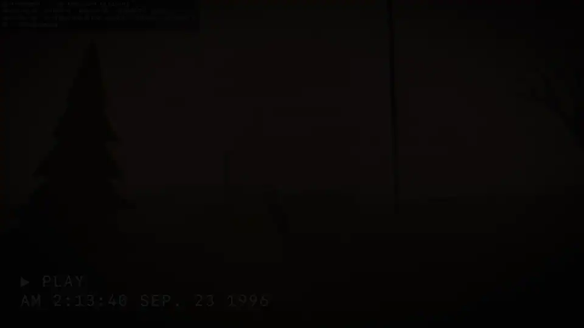
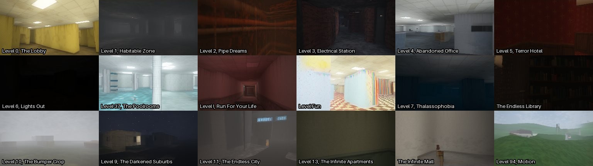

# noclip: a playable neural world model of the Backrooms

[](https://huggingface.co/yelarys/noclip/resolve/main/demo.mp4)

*Play, recorded from the screen. Click for the video with sound.*

Updates on X: [@yelaryss](https://x.com/yelaryss)

A neural network that is the game. It is shown the last few frames and your keys and mouse, and it draws the next
frame, ten times a second. There is no map and no engine behind the picture: rooms are invented as you walk.

It learned this from a procedural simulator of 18 Backrooms levels (in `sim/`), and is played without it. The model
has 211M parameters, was trained from scratch, and runs in real time on one mid-range GPU.



*The first frame the model invents for each of its 18 levels, from nothing but the level's number.*

## Try it

You need an NVIDIA GPU with about 4 GB of free memory, and Python 3.10 or newer (3.12 is what it was built
and tested with, on Linux).

```
git clone https://github.com/Yelar/noclip
cd noclip
pip install -r requirements.txt
python -m wm.play
```

On Windows the PyTorch that pip installs cannot use the GPU, so install the CUDA build first (with Python 3.12):

```
git clone https://github.com/Yelar/noclip
cd noclip
pip install torch==2.8.0 --index-url https://download.pytorch.org/whl/cu128
pip install -r requirements.txt
python -m wm.play
```

Windows is not tested. It runs uncompiled there (compiling is used on Linux only), so frames take longer than
the numbers below.

If it prints `no CUDA device` on a machine that has an NVIDIA GPU, the PyTorch that pip chose is built for a newer
driver than yours. Install the build for your driver ([pytorch.org](https://pytorch.org/get-started/locally/));
`pip install torch==2.8.0` is what this was tested with, on a driver for CUDA 12.8.

The first start downloads the model (2.2 GB, from [Hugging Face](https://huggingface.co/yelarys/noclip)) and the
autoencoder it builds on, compiles for about a minute, and then prints `ready`. Open http://127.0.0.1:8765/.

If the GPU is in another machine, start it there and forward the port from yours:

```
ssh -N -L 8765:127.0.0.1:8765 you@gpu-machine
```

Controls: click the picture to capture the mouse. `W A S D` walk, `Shift` runs, `F` is the flashlight, `N` falls
into a random level (noclip), the number keys or the level menu fall into a chosen one, `R` starts a new dream,
`E` is meant to open doors, `Esc` frees the mouse. The settings panel changes the number of denoising steps and
how often something is near. The record button saves the session as an mp4 in `rec/`.

Speed: a frame takes 47 ms on an RTX 5000 Ada (comparable to an RTX 4080) with the default 12 denoising
steps, of the 100 ms the game gives it. On a slower GPU the game runs slower instead of skipping frames; fewer
steps in the settings panel make frames cheaper, at the cost of dreams that fall apart sooner.

Without an NVIDIA GPU it starts on Apple's GPU or the CPU (`--device mps` or `cpu`), uncompiled and well below
the game's speed: on 12 CPU cores a frame takes 2.5 s. The CPU path is tested; the Apple one is not.

## What to expect

- **It holds together long enough for real play.** A level stays a place for tens of seconds at a time. When the
  picture does dissolve, the server drops you into another level.
- **Walking and looking work. Doors and entities turned out to be harder.** Both appear in the dreams, but not
  reliably when you ask for them.
- **Places are remembered for a moment.** Turn around and the room is usually still there; walk away, come back,
  and it is not.
- **It looks like its simulator.** 512x288 pixels, 10 frames a second, the simulator's textures and lighting.

## How it works

1. **The simulator** (`sim/`) is a batched ray caster written in PyTorch: 64 games at once on one GPU, about 300
   frames a second with encoding. Each level has its own generator for the map, textures, lamps and entities. A
   scripted explorer plays them: it walks, looks around, opens doors, runs from what follows it, and dies.
2. **Frames to latents.** A pretrained autoencoder ([DC-AE](https://arxiv.org/abs/2410.10733), 32x downsampling)
   turns a 512x288 frame into a 16x9 grid of 32 numbers each. Two parts of it are replaced: the decoder is
   fine-tuned on the simulator's frames (34.8 to 37.1 dB on held-out frames, `wm/ae_tune.py`), and a small
   network is trained to give the encoder's latents several times faster (`wm/enc.py`).
3. **The model** (`wm/model.py`) is a causal transformer over the latent grids of the last 24 frames. Attention
   is split into within-a-frame and across-frames-at-the-same-place. Each frame is told the action that led to it
   and the level. It is trained by flow matching: every frame of a window is predicted from the lightly noised
   frames before it, in one pass.
4. **Against drift.** A model that has only continued perfect frames falls apart when it continues its own. So
   for half of the batches the context frames are the model's own one-pass estimates, and the targets stay the
   real frames (`hat_p` in `wm/task.py`). On a 71M model at equal training this brought dreams 5 dB closer to
   the simulator after 9 s.
5. **Memory of places** (`wm/memory.py`). Besides its window the model is shown up to 8 frames from longer ago
   that were seen from nearly the same spot in nearly the same direction. In training they are picked by the
   simulator's recorded poses; in play the pose is reckoned from your keys and the frames are the model's own.
6. **Playing** (`wm/play.py`, `wm/fast.py`, `wm/web/`). The context's attention keys and values are cached, so a
   denoising step costs one frame's tokens. Each frame is drawn in 12 steps with a second-order sampler, decoded,
   and sent as a JPEG over a websocket. The frame pass and the decoder run as CUDA graphs. Twelve steps are for
   stability, not sharpness: with 6 a single frame looks the same, but dreams fall apart sooner.

## The released model

| | |
|---|---|
| Parameters | 211M (width 768, 16 layers, 12 heads) |
| Input | 24 frames of 16x9x32 latents, 11 action columns, the level |
| Training data | 16M frames (440 hours of scripted play) in the last stage; nothing but the simulator |
| Training | from scratch, about 123M frames in stages while the simulator grew from 12 to 18 levels |
| Hardware | 6 to 11 RTX 5000 Ada GPUs for two days |
| Replay of recorded keys, nobody steering | its frames stay close to the simulator's for the first second (26.7 dB PSNR); twelve seconds in it draws rooms of its own (17.3 dB) |

The three last action columns are not keys but the game's state: something is near, the lamps are out, the lamps
are red. In play a director sets the first (the settings panel's "dread"). The model barely responds to it, and
the other two are left at zero.

## Train your own

Everything below needs one NVIDIA GPU. `pip install torchvision lpips` for the two autoencoder tools.

```
# 1. Data: 64 parallel games, 256 frames a chunk. A million frames are 61 chunks and about 9 GB.
python -m sim.gen --out data/train --name a --seed 1 --chunks 61 --ae dcae-lite
python -m sim.gen --out data/val   --name v --seed 2 --chunks 2  --ae dcae-lite
python -m wm.data stats data/train && cp data/train/stats.json data/val/

# 2. The model: size s is 71M parameters, b is 211M.
python -m wm.train --data data/train --val data/val --out runs/s1 --size s --frames 24 --mem 8 --hat_p 0.5 --steps 20000

# 3. Look at it, then play it.
python -m wm.sample --ckpt runs/s1/model.pt --data data/val --out runs/s1/dreams --ae dcae-lite
python -m wm.play   --ckpt runs/s1/model.pt --data data/val --ae dcae-lite
```

`python -m sim.gen --preview DIR` writes contact sheets and a video of every level, to see the simulator itself.
With the released model's fast encoder, datasets render several times faster (about 300 frames a second):
`--ae dcae-lite,enc=PATH/encoder.safetensors` (the file is in the model's folder, which `python -m wm.play`
prints at start).

The released model was trained on several GPUs at once with a trainer that is not part of this repository
(`elastic.py` in the code's comments; `wm/task.py` is its task, and `wm/train.py` runs the same task on one GPU).

`tools/` has the measuring scripts: `act_gain.py` (which inputs the model responds to), `blank_stats.py`
(how much there is to see in a dataset's frames), `mem_gain.py` (what the memory is worth), `play_prof.py` (where
a played frame's time goes), `sampler.py` (how few steps draw the same frame), `train_prof.py`, `sim_stats.py`.

## Dataset format

A dataset is a folder of chunks. One chunk holds B parallel episodes for T consecutive frames.

```
NAME-00000.act.npy   float32 [B, T, A]         action that led to frame t (act[t] turns frame t-1 into frame t)
NAME-00000.lvl.npy   int16   [B, T]            level the player is in (or is falling into) at frame t
NAME-00000.aux.npy   float32 [B, T, X]         ground truth for analysis: position, heading, nearest entity, ...
NAME-00000.lat.npy   float16 [B, T, C, h, w]   frames in the autoencoder's latent space; written last
meta.json            fps, resolution, names of the action, level and aux columns, the autoencoder
stats.json           per-channel mean and std of the latents, fixed for a model's life
```

Actions (A = 11), one row per frame: `forward` and `right` (-1, 0, 1), `turn` and `pitch` (the change during the
frame, divided by its maximum), `sprint`, `light` (the flashlight is on), `noclip` (1 on the frame the player
falls into the level `lvl` names), `use` (1 on the frame E is pressed), then the game's state: `presence`,
`blackout`, `red`.

## Licence and credits

Code and model weights: Apache License 2.0 (`LICENSE`).

The frame autoencoder is DC-AE-lite by MIT HAN Lab and NVIDIA
([`mit-han-lab/dc-ae-lite-f32c32-sana-1.1-diffusers`](https://huggingface.co/mit-han-lab/dc-ae-lite-f32c32-sana-1.1-diffusers)),
downloaded from its own repository at first start. The released `decoder.safetensors` is its decoder, modified
by fine-tuning on this simulator's frames; `encoder.safetensors` is a separate network trained to reproduce its
encoder's output.

```
@article{chen2024deep,
  title={Deep Compression Autoencoder for Efficient High-Resolution Diffusion Models},
  author={Chen, Junyu and Cai, Han and Chen, Junsong and Xie, Enze and Yang, Shang and Tang, Haotian and Li, Muyang and Lu, Yao and Han, Song},
  journal={arXiv preprint arXiv:2410.10733},
  year={2024}
}
```

The Backrooms is a collaborative internet fiction. The level names and ideas come from its community wikis; the
maps, textures and code here are this project's own. It is not affiliated with any Backrooms film, game or wiki.
