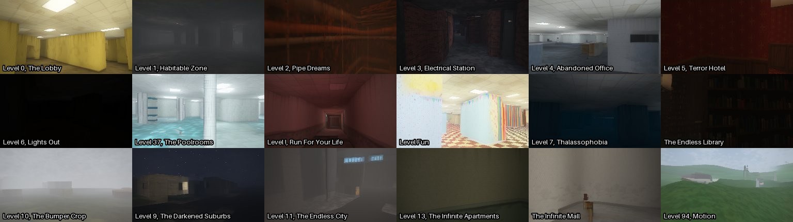

# noclip: a playable neural world model of the Backrooms

<video controls src="https://huggingface.co/yelarys/noclip/resolve/main/demo.mp4"></video>

Updates on X: [@yelaryss](https://x.com/yelaryss)

A 211M-parameter transformer that draws a first-person game frame by frame from your keys and mouse, ten frames a
second, in real time on one GPU. It was trained from scratch on a procedural simulator of 18 Backrooms levels and
is played without it: there is no map and no engine behind the picture.

Code, simulator, training and the play server: **https://github.com/Yelar/noclip**



## Play it

An NVIDIA GPU with about 4 GB of free memory, Python 3.10 or newer:

```
git clone https://github.com/Yelar/noclip
cd noclip
pip install -r requirements.txt
python -m wm.play          # downloads this repository once, then open http://127.0.0.1:8765/
```

On Windows the PyTorch that pip installs cannot use the GPU: with Python 3.12, run
`pip install torch==2.8.0 --index-url https://download.pytorch.org/whl/cu128` before
`pip install -r requirements.txt`. Windows is not tested.

`W A S D` walk, the mouse looks, `Shift` runs, `F` flashlight, `N` falls into another level, `R` new dream.

## Files

| File | What | Size |
|---|---|---|
| `model.safetensors`, `config.json` | the world model (float32) and its shape, latent statistics, training options | 842 MB |
| `decoder.safetensors` | frame decoder: DC-AE-lite's decoder, fine-tuned on the simulator's frames | 1.07 GB |
| `encoder.safetensors` | fast frame encoder (ConvNeXt-S trained to give DC-AE-lite's latents); only for making datasets | 245 MB |
| `events.safetensors` | a small reader of blows and deaths off the latents, for the sounds | 0.4 MB |
| `meta.json` | level names, frame rate, action scale | |
| `start/` | recorded frames that dreams start from, 12 stretches of 2.4 s per level | 48 MB |
| `demo.mp4` | the video above: play, recorded from the screen | 27 MB |

## The model

- Causal transformer over the 16x9x32 latents (DC-AE, 32x downsampling) of the last 24 frames of 512x288 video
  at 10 frames a second; width 768, 16 layers, 12 heads. Attention is factorised into within-a-frame and
  across-frames-at-the-same-place.
- Conditioned per frame on 11 action columns (move, strafe, turn, pitch, sprint, flashlight, noclip, use, and
  three state columns) and on the level.
- Trained by flow matching with teacher forcing on lightly noised context; for half of the batches the context
  is the model's own one-pass estimate of the frames, which is what keeps a dream from drifting at once.
- Up to 8 memory frames, recalled by pose from earlier in the dream, are shown besides the window.
- Sampling: 12 steps of a second-order (Adams-Bashforth) sampler per frame, no guidance.

## Training

From scratch, on nothing but the simulator in the repository. About 123M frames in stages (53M, 40M, 30M) while
the simulator grew from 12 to 18 levels; the last stage drew its windows from 16M frames (440 hours of scripted
play). 6 to 11 RTX 5000 Ada GPUs for two days. The weights are a running average over training rounds.

## Measured

The first three rows are a replay with nobody steering: the model is shown 8 frames recorded from the simulator
and then only the recorded key presses, and every frame it draws is compared with the simulator's frame for the
same moment (96 episodes, 12 sampling steps).

| | |
|---|---|
| How close its frames are to the simulator's in the first second | close: 26.7 dB (PSNR; 30 dB would be nearly identical) |
| The same, twelve seconds in | a different picture: 17.3 dB. By then it draws rooms of its own, not the simulator's |
| Blank frames 9 to 12 s in (a bare wall, fog, darkness) | 48% (the simulator's own frames: 12%) |
| Time per frame, RTX 5000 Ada, 12 steps | 47 ms (the game allows 100) |
| GPU memory while playing | 3.1 GB |

## Limits

- It holds together long enough for real play: a level stays a place for tens of seconds at a time, and when the
  picture dissolves the play server drops the player into another level.
- Walking and looking are obeyed. Doors and entities turned out to be harder: both appear, but not reliably on
  request.
- Places are remembered for moments, not for a walk around the block.
- It reproduces its simulator's look: 512x288, 10 frames a second, procedural textures.
- Not evaluated on anything but its own simulator.

## Licence and credits

Apache License 2.0.

`decoder.safetensors` is a modified copy (fine-tuned) of the decoder of
[`mit-han-lab/dc-ae-lite-f32c32-sana-1.1-diffusers`](https://huggingface.co/mit-han-lab/dc-ae-lite-f32c32-sana-1.1-diffusers)
by MIT HAN Lab and NVIDIA; the encoder side of that autoencoder is downloaded from its own repository at first
start.

```
@article{chen2024deep,
  title={Deep Compression Autoencoder for Efficient High-Resolution Diffusion Models},
  author={Chen, Junyu and Cai, Han and Chen, Junsong and Xie, Enze and Yang, Shang and Tang, Haotian and Li, Muyang and Lu, Yao and Han, Song},
  journal={arXiv preprint arXiv:2410.10733},
  year={2024}
}
```

The Backrooms is a collaborative internet fiction; level names and ideas come from its community wikis. This
project is not affiliated with any Backrooms film, game or wiki.
